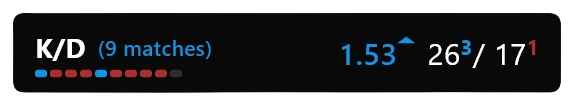
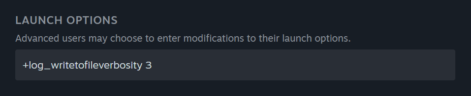
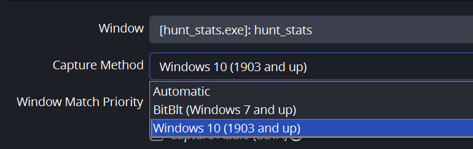

## What is this?

A minimal application for displaying **Hunt: Showdown** statistics for the current session.

## Available statistics

- Number of matches
- Deaths, including a separate count for the current match
- Kills, including a separate count for the current match
- K/D ratio
- Match results in chronological order: successful extraction or death

> [!TIP]
> Place a `kill.wav` or `death.wav` file in the assets directory to play a sound when you get a kill or die.

## Setup

1. Download the latest application version (2.0.0 or later) from GitHub [Releases](https://github.com/dealnotedev/dart_hunt_kda/releases).
2. Enable more detailed game logs by adding `+log_writetofileverbosity 3` to the game's launch options in Steam.

   

3. Enable **Nvidia Highlights** recording for **Hunter killed** and **Player downed**. There is currently no solution for Radeon or other GPUs.
4. Optionally, clear `\steamapps\common\Hunt Showdown\user\logbackups` periodically to remove accumulated old logs.

> [!TIP]
> To capture the statistics banner in OBS on Windows 11, use the `Windows 10 (1903 and up)` capture method.

